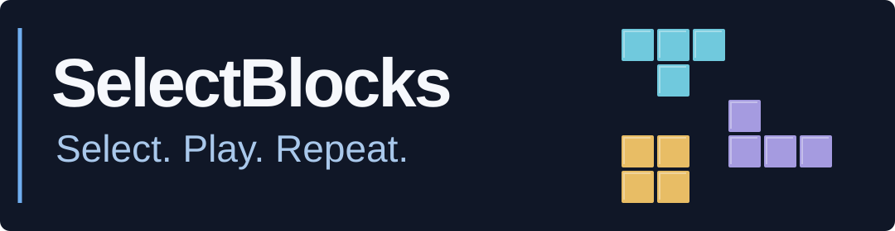

# SelectBlocks

**Select a word. Open a retro falling-block game without leaving your app.**

[](https://github.com/dinaxy148822822-create/SelectBlocks/actions/workflows/build.yml)
[](https://github.com/dinaxy148822822-create/SelectBlocks/releases/latest)
[](LICENSE)

**[Download](https://github.com/dinaxy148822822-create/SelectBlocks/releases)** · **[Install](docs/en/INSTALL.md)** · **[Compatibility](docs/en/COMPATIBILITY.md)** · **[Build](docs/en/BUILDING.md)** · **[Русский](README.md)**

SelectBlocks is a native jailbreak tweak written in Objective-C/Logos and C. Select `tetris`, `тетрис`, `テトリス`, or another [recognized name](TriggerWords.json) in a supported text view, and a small game opens in the current app. Close it to return to what you were doing.

> **A jailbreak and working tweak injection are required.** This is not an App Store app or a jailbreak tool. Text-selection support varies by app. Broader build targets are not a claim of testing on every device.

## A small game, thoughtfully integrated

| Play | Feel | Stay in control |
| --- | --- | --- |
| 10 × 20 board and seven pieces | Retro panels and procedural beveled blocks | Pause, restart and close at the top |
| Seven-bag randomizer and three-piece preview | A selected-word entrance animation, when geometry is available | Movement, rotation and hold at the bottom |
| Hold, ghost piece, soft drop and hard drop | Eight newly synthesized chiptune effects | Persistent **SND / OFF** toggle |
| Score, lines, levels and a per-app record | Reduced-motion fallback | Per-app saves and automatic pause when leaving the app |

The rotation system uses simple wall kicks, **not SRS**. Modern guideline features such as T-spins, combos, back-to-back bonuses and online play are not implemented. There is no background music.

## Get started

1. Open **[Releases](https://github.com/dinaxy148822822-create/SelectBlocks/releases)** and read the notes for the exact release you intend to install.
2. Download the appropriate **`.deb` asset**, not GitHub's source-code ZIP.
3. Install with a compatible package manager such as Sileo or Zebra, or open the package in Filza. Restart affected apps and follow any restart prompt.
4. In an app with tweak injection enabled, select a recognized name and wait briefly.

**Know your jailbreak's method for starting without tweak injection before installing.** If an app crashes, disable injection for it or remove SelectBlocks. See the [installation and recovery guide](docs/en/INSTALL.md).

## Pick the right package

These are the **build targets on `main`**, introduced for the 1.1.0 source tree. An attached release asset is the authority for what has actually shipped; older releases can have narrower requirements.

| File suffix | Layout | Build target | Important limitation |
| --- | --- | --- | --- |
| `_rootless.deb` | Standard rootless | iOS 15+, arm64 + modern arm64e | Requires a compatible bootstrap and injector |
| `_rootful.deb` | Rootful | iOS 14+, arm64 + modern arm64e | Not interchangeable with rootless |
| `_rootful-legacy.deb` | Rootful | iOS 12–13, arm64 | No legacy arm64e system-process support on A12+ |

**iOS 18 is within the modern build ranges, not independently certified.** 32-bit devices, iOS below 12, old arm64e ABI on iOS 12–13 and nonstandard bootstraps are outside the declared coverage. Read [compatibility details](docs/en/COMPATIBILITY.md) before installing.

## Controls

| Location | Button | Action |
| --- | --- | --- |
| Top | **DROP** | Instantly drop and lock the current piece |
| Top | **PAUSE / PLAY** | Pause or continue |
| Top | **RESET** | Start a new game after confirmation |
| Top | **EXIT** | Save and close the game |
| Header | **SND / OFF** | Toggle sound effects for the current app |
| Bottom | **LEFT / RIGHT** | Move; hold for repeat |
| Bottom | **B / A** | Rotate counterclockwise / clockwise |
| Bottom | **DOWN** | Soft drop; hold for repeat |
| Bottom | **HOLD** | Store or swap a piece once per piece |

Score: **100 / 300 / 500 / 800 × current level** for one through four lines. Soft drop adds one point per cell; hard drop adds two. The level increases every ten lines.

## Trigger names

Examples: `tetris` · `тетрис` · `тетріс` · `テトリス` · `테트리스` · `تتريس` · `טטריס` · `俄罗斯方块`.

The [full list](TriggerWords.json) contains 18 spellings, not 18 independently tested language environments. Matching normalizes case, compatible full-width forms, selected diacritics and Arabic marks. Only an entire recognized selection triggers the game; `let's play tetris` does not. This is an explicit alias list, not an automatic translator.

## Privacy and limitations

- No app-level networking, analytics or text-selection log is implemented.
- Only a recognized word is used to create the entrance animation; surrounding app content is not captured.
- Game state, the record and the sound preference live in each host app's preferences. Synthesized sounds are cached locally.
- Web selection is experimental in behavior: main-document `WKWebView` support after a long press. Iframes, protected fields, PDFs and custom editors may not work.
- No bypass of jailbreak detection or disabled tweak injection is included.

Full details: **[Privacy](docs/en/PRIVACY.md)** · **[FAQ and troubleshooting](docs/en/FAQ.md)** · **[Security](docs/en/SECURITY.md)**.

## Build and contribute

Use a configured [Theos](https://theos.dev/) environment:

```bash
git clone https://github.com/dinaxy148822822-create/SelectBlocks.git
cd SelectBlocks
bash scripts/build.sh rootless
```

Use `rootful` or `rootful-legacy` for the other variants. GitHub Actions builds and validates the packages separately. Passing tests or compilation does **not** certify runtime behavior.

**[Build guide](docs/en/BUILDING.md)** · **[Contributing](docs/en/CONTRIBUTING.md)** · **[Changelog](docs/en/CHANGELOG.md)** · **[Report a bug](https://github.com/dinaxy148822822-create/SelectBlocks/issues/new/choose)**

## License and acknowledgements

Released under the [MIT License](LICENSE). Built using the Theos toolchain and Apple's platform frameworks; those projects retain their respective rights and licenses.

SelectBlocks is an independent falling-block implementation. It is not affiliated with or endorsed by the owners of Tetris. Commercial game artwork, recordings and music are not bundled; the visuals and effects are generated for this project. The selection names identify the trigger behavior, not an official affiliation.
